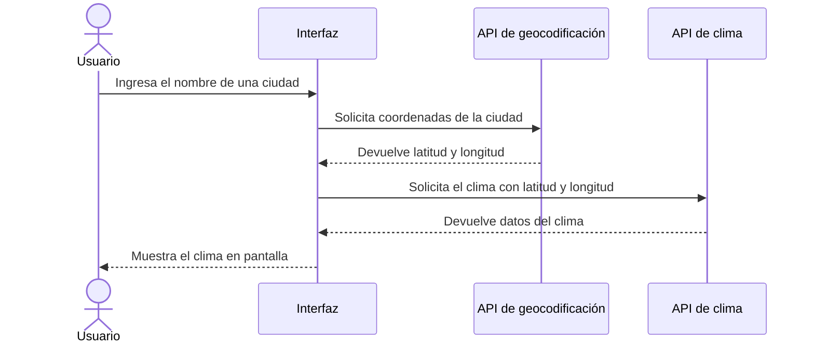

# AGENTS.md

Instrucciones para el agente (opencode). Tu tarea es **leer este proyecto completo** y **crear un `README.md`** en la raíz, siguiendo los pasos de abajo. No inventes información: todo debe salir del código, de las carpetas y del historial de git del proyecto.

---

## 0. Reconocimiento previo (antes de escribir nada)

1. Lista la estructura del proyecto (archivos `.html`, `.js`, `.css`, carpetas, `package.json` si existe).
2. Lee todos los archivos JavaScript y HTML. Identifica:
   - Qué hace cada **Pregunta** (Pregunta 1, Pregunta 2, Pregunta 3, etc.) y en qué archivo(s) vive.
   - Si el proyecto usa **ES Modules** (`import` / `export`, `type="module"`).
   - Qué APIs externas se consumen (en especial la de geocodificación y la de clima de la Pregunta 3).
3. Revisa si existe la carpeta `img/` y qué capturas contiene. Si no existe, créala (`mkdir img`).
4. Obtén la URL del repositorio con `git remote -v` para construir el enlace a GitHub Pages:
   `https://<usuario>.github.io/<repositorio>/`
5. Revisa `git log` para conocer el estado actual de los commits.

---

## 1. Encabezado del README

Agrega al inicio de `README.md`:

- **Título** del proyecto (`# Título`).
- **Descripción breve** (2–3 líneas) de qué hace el proyecto.
- **Enlace a GitHub Pages** (`🔗 Demo: https://<usuario>.github.io/<repositorio>/`).
- **Al menos 3 badges** de shields.io, por ejemplo:

```md


```

Puedes agregar más (HTML5, CSS3, GitHub Pages, licencia) si corresponden al proyecto.

---

## 2. Tabla de contenidos y secciones por pregunta

1. Crea una **tabla de contenidos** con enlaces ancla a **cada** sección del README, por ejemplo:

```md
## Tabla de contenidos
- [Pregunta 1](#pregunta-1)
- [Pregunta 2](#pregunta-2)
- [Pregunta 3](#pregunta-3)
- [Diagrama de flujo](#diagrama-de-flujo-pregunta-3)
- [Bitácora de IA](#bitácora-de-ia)
- [Checklist de entregables](#checklist-de-entregables)
```

2. Crea **una sección por pregunta** (`## Pregunta N`). Cada sección debe incluir:
   - Una explicación corta de qué resuelve.
   - **Fragmentos clave del código real** del proyecto en bloques marcados como `js`:

     ````md
     ```js
     // fragmento real copiado del proyecto
     ```
     ````

   - Las **capturas de pantalla** guardadas en `img/` y referenciadas con ruta relativa:
     ``
   - Si falta una captura, deja el marcador `<!-- TODO: agregar img/pregunta-N.png -->` y avísame al final; **no inventes imágenes**.

---

## 3. Diagrama Mermaid (Pregunta 3)

Dentro de la sección de la Pregunta 3 (o en una sección propia enlazada desde la tabla de contenidos), agrega un `sequenceDiagram` con el flujo:
**Usuario → interfaz → API de geocodificación → API de clima → interfaz.**

Usa esta base y ajústala a los nombres reales de las APIs y funciones que encuentres en el código:

````md

````

---

## 4. Bitácora de IA

Crea la sección `## Bitácora de IA` con **al menos 6 entradas (mínimo 2 por pregunta)**, usando esta tabla base:

```md
| # | Pregunta | Herramienta de IA | Prompt utilizado | Resultado obtenido | Ajustes / validación realizada |
|---|----------|-------------------|------------------|--------------------|--------------------------------|
| 1 | Pregunta 1 | ... | ... | ... | ... |
| 2 | Pregunta 1 | ... | ... | ... | ... |
| 3 | Pregunta 2 | ... | ... | ... | ... |
| 4 | Pregunta 2 | ... | ... | ... | ... |
| 5 | Pregunta 3 | ... | ... | ... | ... |
| 6 | Pregunta 3 | ... | ... | ... | ... |
```

Reglas:
- Rellena las filas con usos **plausibles y coherentes con el código** (por ejemplo: generar una función, depurar un error de `fetch`, explicar el manejo de promesas, mejorar el manejo de errores).
- En "Ajustes / validación" indica cómo se comprobó el resultado (pruebas manuales, consola del navegador, comparación con documentación).
- Si el proyecto ya tiene una bitácora o la tabla base definida por el docente, **respétala** y solo complétala.
- Al terminar, indícame que revise y corrija estas entradas para que reflejen su uso real de la IA.

---

## 5. Checklist de entregables

Agrega la sección `## Checklist de entregables` con casillas de tareas de Markdown. Marca como completado (`[x]`) **solo** lo que verifiques que existe:

```md
- [x] Pregunta 1 resuelta
- [x] Pregunta 2 resuelta
- [x] Pregunta 3 resuelta
- [x] Capturas guardadas en `img/`
- [x] Diagrama Mermaid de la Pregunta 3
- [x] Bitácora de IA (6+ entradas)
- [x] README con badges y tabla de contenidos
- [x] Publicado en GitHub Pages
- [x] Mínimo 6 commits progresivos
```

---

## 6. Commits progresivos (mínimo 6)

Haz los commits **a medida que avanzas**, no uno solo al final. Usa mensajes descriptivos en español, en imperativo. Secuencia sugerida:

1. `docs: agrega título, descripción, enlace a GitHub Pages y badges al README`
2. `docs: agrega tabla de contenidos al README`
3. `docs: agrega sección de Pregunta 1 con fragmentos de código y captura`
4. `docs: agrega sección de Pregunta 2 con fragmentos de código y captura`
5. `docs: agrega sección de Pregunta 3 con diagrama Mermaid del flujo`
6. `docs: agrega bitácora de IA con 6 entradas`
7. `docs: agrega checklist de entregables`

Comandos de referencia:

```bash
git add README.md img/
git commit -m "docs: mensaje descriptivo"
```

Antes de empezar, ejecuta `git log --oneline` para contar los commits existentes y asegúrate de que, al final, el historial tenga **al menos 6 commits** con mensajes claros. No uses `git push --force` ni reescribas el historial.

---

## Reglas generales

- Escribe el README en **español**.
- Usa solo código que exista en el proyecto; no inventes funciones ni resultados.
- Verifica que los enlaces de la tabla de contenidos coincidan con los títulos reales (los anclas de GitHub van en minúsculas y con guiones).
- Verifica que las rutas de las imágenes (`img/...`) apunten a archivos existentes.
- Al terminar, entrega un resumen corto: qué se creó, qué falta (capturas, enlace de Pages) y qué debo revisar manualmente.