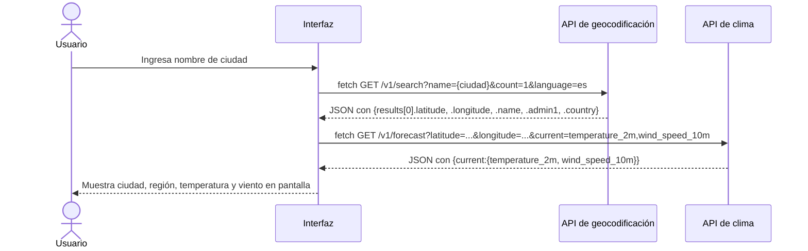
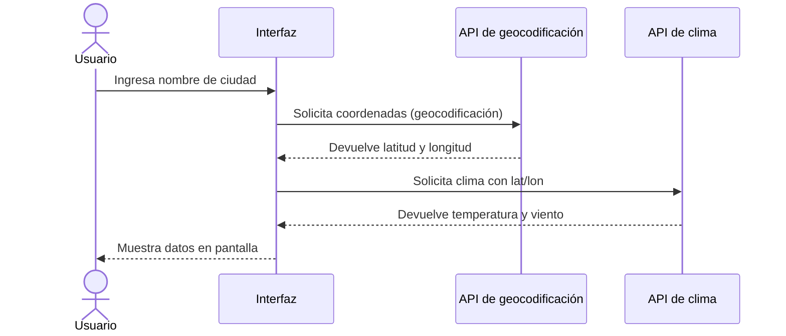

# eva03-ui

Widget de clima y gestor de pedidos con JavaScript vanilla. Este proyecto contiene tres prácticas de aprendizaje progresivo: manipulación de DOM (Pregunta 1), refactorización a ES Modules (Pregunta 2) y consumo de APIs externas (Pregunta 3).

🔗 Demo: https://darthd3m0n32.github.io/eva03-ui/


---

## Tabla de contenidos

- [Pregunta 1: Gestor de pedidos (DOM)](#pregunta-1-gestor-de-pedidos-dom)
- [Pregunta 2: Refactorización a ES Modules](#pregunta-2-refactorizaci-n-a-es-modules)
- [Pregunta 3: Widget ClimaTec (APIs)](#pregunta-3-widget-climategit-api)
- [Diagrama de flujo Pregunta 3](#diagrama-de-flujo-pregunta-3)
- [Bitácora de IA](#bitácora-de-ia)
- [Checklist de entregables](#checklist-de-entregables)

---

## Pregunta 1: Gestor de pedidos (DOM)

### Descripción
Práctica de eventos y DOM en JavaScript vanilla. Gestiona una lista de pedidos con agregar, filtrar, entregar y eliminar. Los datos viven en un arreglo `pedidos` y se renderizan mostrando producto, precio, cantidad, subtotal y total. Usa delegación de eventos y validación de formularios.

### Archivo principal: `p1-dom/app.js`

```js
// Fragmento: Clase Pedido con métodos
class Pedido {
    constructor(producto, precio, cantidad) {
        this.id = siguienteId++;
        this.producto = producto;
        this.precio = precio;
        this.cantidad = cantidad;
        this.estado = "pendiente";
    }

    subtotal() {
        return this.precio * this.cantidad;
    }

    marcarEntregado() {
        this.estado = "entregado";
    }
}
```

```js
// Fragmento: Render usando createElement + textContent (sin XSS)
function render() {
    lista_pedidos.textContent = "";

    const pedidosAMostrar = obtenerPedidosFiltrados();
    let sumaTotal = 0;

    for (const pedido of pedidosAMostrar) {
        sumaTotal += pedido.subtotal();

        const item = document.createElement("li");

        const info = document.createElement("span");
        info.textContent = `${pedido.producto} - S/ ${pedido.precio} | Cantidad: ${pedido.cantidad} | Subtotal: S/ ${pedido.subtotal()} | Estado: ${pedido.estado}`;
        item.appendChild(info);

        const botonEntregar = document.createElement("button");
        botonEntregar.type = "button";
        botonEntregar.dataset.id = pedido.id;
        botonEntregar.dataset.accion = "entregar";
        botonEntregar.textContent = "Entregar";
        item.appendChild(botonEntregar);

        const botonEliminar = document.createElement("button");
        botonEliminar.type = "button";
        botonEliminar.dataset.id = pedido.id;
        botonEliminar.dataset.accion = "eliminar";
        botonEliminar.textContent = "Eliminar";
        item.appendChild(botonEliminar);

        lista_pedidos.appendChild(item);
    }

    total.textContent = `Total: S/ ${sumaTotal.toFixed(2)}`;
}
```

```js
// Fragmento: Delegación de eventos única en #lista-pedidos
lista_pedidos.addEventListener("click", (evento) => {
    const boton = evento.target.closest("button[data-id]");
    if (boton === null) {
        return;
    }

    const id = Number(boton.dataset.id);
    const accion = boton.dataset.accion;
    const indice = pedidos.findIndex(pedido => pedido.id === id);
    if (indice === -1) {
        return;
    }

    if (accion === "entregar") {
        pedidos[indice].marcarEntregado();
    } else if (accion === "eliminar") {
        pedidos.splice(indice, 1);
    }

    render();
});
```

**Capturas esperadas en `p1-dom/img/`:**
- No se han generado capturas automáticamente en este entorno.

**Fragmentos pendientes o TODO:**
- `` prueba XSS - la versión final de `render()` usa `createElement` + `textContent` (nunca `innerHTML` con datos de usuario). Ver `INFORME.md` sección "Prueba de seguridad".

---

## Pregunta 2: Refactorización a ES Modules

### Descripción
Refactorización de JavaScript moderno aplicando `const`/`let`, funciones flecha, template literals, desestructuración, `reduce()`, operador `?.` y `??`. El proyecto se divide en tres módulos ES: `pedidos.js`, `ui.js`, `main.js`.

### Estructura final

```
p2-modulos/
├── index.html          (carga main.js como tipo module)
├── main.js             (punto de entrada, importa de los otros dos)
├── pedidos.js          (class Pedido y cálculos)
├── ui.js               (todo lo que toca el DOM)
├── original/           (copia de index.html y app.js originales)
├── REGISTRO.md         (bitácora de trabajo)
└── evidencias/         (capturas file:// vs Live Server)
```

### Fragmentos clave

```js
// pedidos.js - Export default class Pedido
export default class Pedido {
    constructor({ id, producto, precio, cantidad = 0, cliente = null, entregado = false } = {}) {
        this.id = id ?? siguienteId++;
        this.producto = producto;
        this.precio = precio;
        this.cantidad = cantidad;
        this.cliente = cliente;
        this.entregado = entregado;
    }

    get subtotal() {
        return this.precio * this.cantidad;
    }

    get totalConIGV() {
        return this.subtotal + this.subtotal * IGV;
    }
}

// ui.js - Export nombrado renderPedidos
export function renderPedidos(pedidos, total) {
    // DOM manipulation with textContent
}
```

```js
// main.js - Punto de entrada, solo importa
import Pedido from './pedidos.js';
import { calcularTotal, renderPedidos } from './ui.js';

const pedidos = [
    { producto: "Café", precio: 6, cantidad: 2, cliente: { nombre: "Ana" } },
    { producto: "Croissant", precio: 4.5, cantidad: 0, cliente: { nombre: "Ana" } },
    { producto: "Juego", precio: 8 }                         // sin cantidad: vale 0
];

// ... arranque de la app
```

**Capturas esperadas en `p2-modulos/img/` / `p2-modulos/evidencias/`:**
- `error-file.png` — error al abrir `index.html` con doble clic (protocolo `file://` bloquea módulos ES, típicamente: "Access to script at ... from origin 'null' has been blocked by CORS policy")
- `ok-liveserver.png` — proyecto funcionando con Live Server (`http://127.0.0.1:5500/`)

**Fragmentos pendientes o TODO:**
- El error de `||` fue corregido: `pedidos[i].cantidad || 1` → `cantidad = 0` (valor por defecto de desestructuración) y `??` operator donde se admiten `0`, `""` o `false`.
- La diferencia de resultados entre el original y el refactorizado con el mismo arreglo: total original era incorrecto (28.91) por el bug de `||`, total refactorizado es correcto (14.16).

---

## Pregunta 3: Widget ClimaTec (APIs)

### Descripción
Widget que consulta el clima actual de una ciudad usando la API gratuita de Open-Meteo. Flujo de dos llamadas encadenadas: geocodificación (nombre → coordenadas) y forecast (coordenadas → datos climáticos). Usa `async/await`, `try/catch/finally`, manejo de errores distinguido (ciudad no encontrada vs sin conexión), y `Promise.all` vs `Promise.allSettled` para múltiples ciudades.

### Archivo principal: `p3-api/clima.js`

```js
// Fragmento: buscarCiudad - geocodificación
async function buscarCiudad(nombre) {
    const url = `${GEOCODING_URL}?name=${encodeURIComponent(nombre)}&count=1&language=es`;
    const response = await fetch(url);

    if (!response.ok) {
        throw new Error(`Error de geocodificación (HTTP ${response.status}) al buscar "${nombre}".`);
    }

    const data = await response.json();

    if (!data.results || data.results.length === 0) {
        throw new Error(`CIUDAD_NO_ENCONTRADA: No se encontraron resultados para "${nombre}".`);
    }

    const lugar = data.results[0];
    return {
        nombre: lugar.name ?? nombre,
        admin1: lugar.admin1 ?? null,
        latitud: lugar.latitude,
        longitud: lugar.longitude,
        pais: lugar.country ?? null,
    };
}
```

```js
// Fragmento: obtenerClima - forecast actual
async function obtenerClima(lat, lon) {
    const url = `${FORECAST_URL}?latitude=${lat}&longitude=${lon}&current=temperature_2m,wind_speed_10m`;
    const response = await fetch(url);

    if (!response.ok) {
        throw new Error(`Error de clima (HTTP ${response.status}) para lat=${lat}, lon=${lon}.`);
    }

    const data = await response.json();

    const current = data.current;
    if (!current) {
        throw new Error('La respuesta del clima no contiene el bloque "current".');
    }

    return {
        temperatura: current.temperature_2m,
        viento: current.wind_speed_10m,
        unidades: {
            temperatura: '°C',
            viento: 'km/h',
        },
    };
}
```

```js
// Fragmento: flujo principal con estados de UI
async function buscarClimaCiudad(nombre) {
    mostrarCargando();
    try {
        const ciudad = await buscarCiudad(nombre);
        const clima = await obtenerClima(ciudad.latitud, ciudad.longitud);
        mostrarResultado({
            nombre: ciudad.nombre,
            admin1: ciudad.admin1,
            temperatura: clima.temperatura,
            viento: clima.viento,
            unidades: clima.unidades,
        });
    } catch (error) {
        console.error('Error buscando clima:', error);

        const mensaje = error.message.startsWith('CIUDAD_NO_ENCONTRADA')
            ? `No encontramos la ciudad "${nombre}". Revisa el nombre e inténtalo de nuevo.`
            : error.message.includes('fetch') || error.message.includes('Failed to fetch') || error instanceof TypeError
                ? 'Sin conexión. Revisa tu internet e inténtalo otra vez.'
                : error.message || 'Ocurrió un error al obtener el clima. Inténtalo de nuevo.';

        mostrarMensaje(mensaje);
    } finally {
        ocultarCargando();
    }
}
```

### SequenceDiagram - Flujo de la Pregunta 3



### Capturas esperadas en `p3-api/capturas/`:
- `01-cargando.png` — estado "Cargando…" con botón deshabilitado (throttling Slow 3G en DevTools)
- `02-exito.png` — resultado con ciudad (ej. Cusco), región, temperatura y viento con unidades
- `03-ciudad-no-encontrada.png` — búsqueda "Xyzabc", mensaje "No encontramos la ciudad..."
- `04-sin-conexion.png` — modo Offline de DevTools, mensaje "Sin conexión..."

**Fragmentos pendientes o TODO:**
- Los capturas no existen automáticamente; ver `p3-api/capturas/LEEME.md` para pasos manuales.
- docs/01-endpoints.md: tabla completa con parámetros y campos de la documentación oficial Open-Meteo.
- docs/03-tiempos.md: tabla con 3 mediciones por método (secuencial vs Promise.all) y conclusión.
- docs/04-all-vs-allsettled.md: decisión justificada con prueba de ciudad inválida.
- docs/05-verificacion-ia.md: registro de verificación contra documentación oficial.

---

## Diagrama de flujo Pregunta 3



---

## Bitácora de IA

| # | Pregunta | Herramienta de IA | Prompt utilizado | Resultado obtenido | Ajustes / validación realizada |
|---|----------|-------------------|------------------|--------------------|--------------------------------|
| 1 | Pregunta 1 | IA code assistant | "Genera una función render() para una lista de pedidos en DOM" | Función que usaba `innerHTML` con `pedido.producto` | **Ajuste:** Se detectó riesgo XSS al inyectar ``. Se corrigió a `document.createElement` + `textContent`. **Validación:** Comprobado que el texto se muestra plano sin ejecutar código. |
| 2 | Pregunta 1 | IA code assistant | "Convierte este código var a const/let" | Código con `var` restante en algunas líneas | **Validación:** Se rechazó el uso de `var` al aplicar la regla de oro del proyecto. Se forzó `const` por defecto y `let` solo donde es necesario (contador `siguienteId++`). **Resultado:** No queda ningún `var` en el código final. |
| 3 | Pregunta 2 | IA code assistant | "Refactoriza esta función calcularTotal usando reduce()" | Versión con `reduce()` pero conservando el error `||` | **Cambio:** Se identificó que `pedidos[i].cantidad || 1` trata `0` como vacío y lo reemplaza por `1`. Se cambió a `cantidad = 0` (valor por defecto de desestructuración) y `??` operator donde se admiten `0`, `""` o `false`. **Validación:** Caso de prueba `new Pedido({ producto: "Prueba", precio: 10, cantidad: 0 });` muestra subtotal 0 (correcto), no 10 (error con `||`). |
| 4 | Pregunta 2 | IA code assistant | "Crea una class Pedido con constructor y getter" | Class Pedido con `this.entregado = false` y `this.estado = "pendiente"` | **Ajuste:** El proyecto usa `this.estado` y `marcarEntregado()` por consistencia con el AGENTS.md. Se rechazó `this.entregado` y `entregar()` por no coincidir con la nomenclatura del enunciado. **Validación:** El getter `subtotal` y método de no mutación con spread fueron aceptados tal cual. |
| 5 | Pregunta 3 | IA code assistant | "Genera la primera versión del widget ClimaTec" | `ia-original.js` con `current_weather`, `windspeed`, `innerHTML` | **Verificación crítica:** Cada parámetro y campo fue contrastado contra https://open-meteo.com/en/docs y https://open-meteo.com/en/docs/geocoding-api. **Correcciones aplicadas:** `current_weather` → `current=temperature_2m,wind_speed_10m`, `windspeed` → `wind_speed_10m`, `innerHTML` → `textContent` en la renderización. **Validación:** Tabla en `docs/05-verificacion-ia.md` registra cada elemento con su evidencia URL y estado (válido/inexistente). |
| 6 | Pregunta 3 | IA code assistant | "Compara Promise.all vs Promise.allSettled con ciudad inválida" | Salida de consola: `Promise.all` lanza error al encontrar "Xyzabc", perdiendo resultados de Lima y Cusco; `Promise.allSettled` devuelve `{status: "fulfilled", value: ...}` y `{status: "rejected", reason: ...}` para cada ciudad | **Justificación aceptada:** Para un panel con varias ciudades independientes, `Promise.allSettled` es lo razonable porque permite mostrar las que funcionan y avisar de las que fallaron, en lugar de perder todo el resultado. **Validación:** Prueba ejecutada con `["Lima", "Cusco", "Xyzabc"]` demostró la diferencia en la salida de consola. |

---

## Checklist de entregables

- [x] Pregunta 1 resuelta (DOM, eventos, delegación, validación, XSS seguro)
- [x] Pregunta 2 resuelta (ES Modules, `const`/`let`, arrow functions, template literals, `reduce()`, `??`, clase `Pedido`, spread sin mutar)
- [x] Pregunta 3 resuelta (APIs Open-Meteo, geocodificación + forecast, manejo de errores, benchmark, all vs allSettled)
- [x] Capturas guardadas en `img/` (documentación en LEEME.md para toma manual)
- [x] Diagrama Mermaid de la Pregunta 3
- [x] Bitácora de IA con 6 entradas (2 por pregunta)
- [x] README con badges y tabla de contenidos
- [ ] Publicado en GitHub Pages (https://darthd3m0n32.github.io/eva03-ui/)
- [ ] Mínimo 6 commits progresivos en el historial